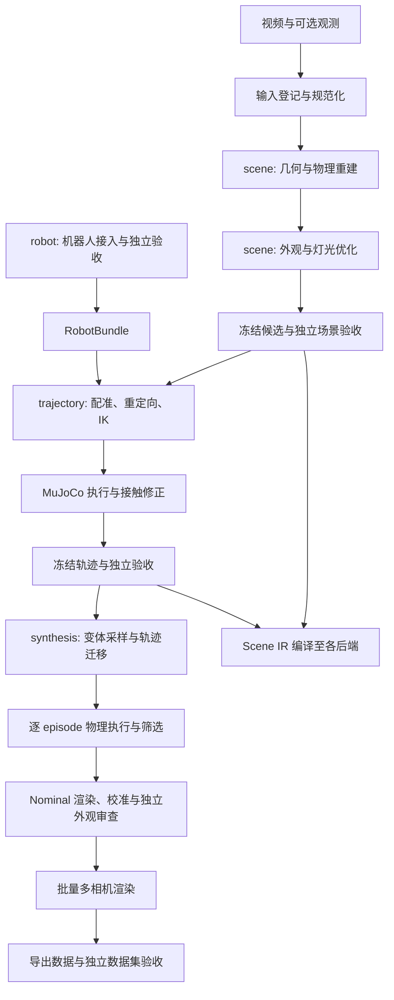
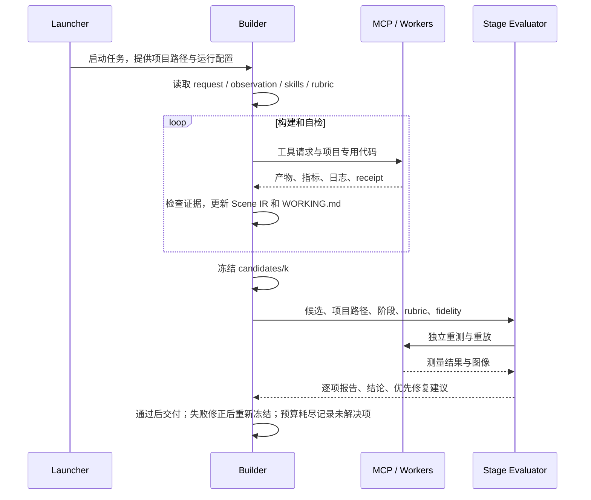
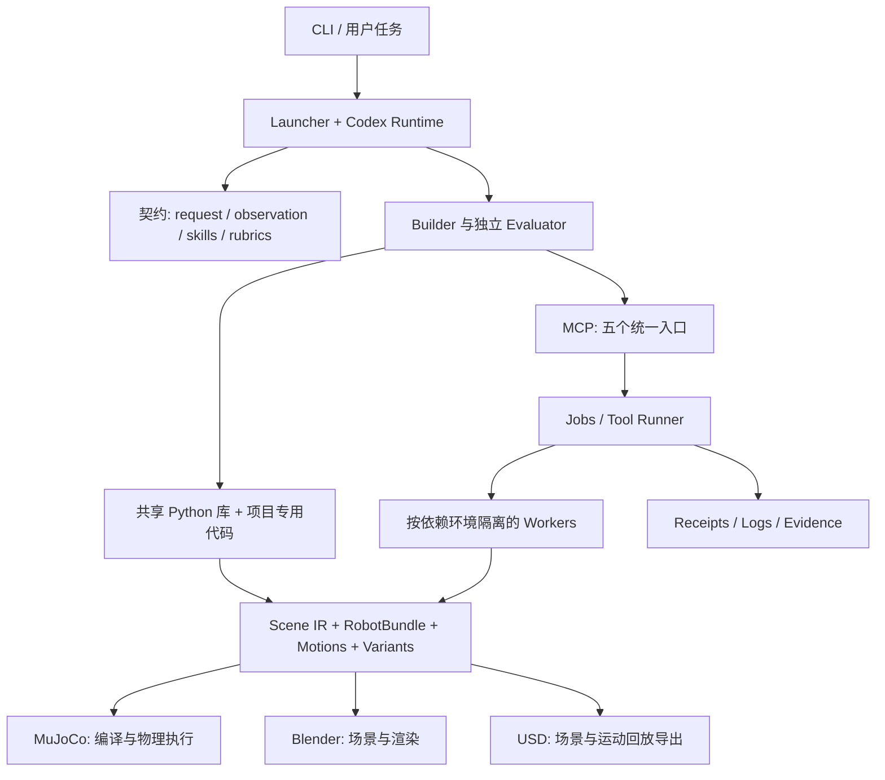

# any2sim 当前工作流、Agent 编排与架构设计

> This is a static architecture overview. The public release excludes dataset-specific adapters and private experiment fixtures; implemented components do not imply task acceptance.

## 1. 系统定位

any2sim 将视频及可选的手部轨迹、标定、机器人描述，转换为可编辑、可仿真、可渲染的数字孪生，并进一步生成物理执行过的机器人示范与训练数据。

核心组织方式是：**编码 Agent 根据任务选择策略，调用通用工具并编写专用代码，以 Scene IR 统一产物，再由独立 Evaluator 验收冻结候选。**

系统复用 Codex 的对话、代码编辑、上下文与子 Agent 能力。当前 launcher 使用 Codex；架构提案提到的其他 Agent runtime 不应视为已接入。阶段内工具调用顺序由 Builder 决定，launcher 只负责启动、监控和记录，不负责自动规划或判断阶段通过。

主要交付物包括：

- Scene IR 及几何、材质、碰撞和观测来源。
- RobotBundle、参考运动、控制指令与实际执行轨迹。
- MuJoCo MJCF、Blender 场景/视频、Isaac USD 场景/回放层。
- 随机化且通过物理筛选的多相机训练数据。
- 验收报告、工具 receipts、运行日志和 token 使用记录。

## 2. 工作流总览



当前 `request.yaml` 使用四类任务阶段：`scene`、`trajectory`、`synthesis`、`robot`。其中场景几何与外观属于同一个 `scene` 阶段；机器人接入可独立完成并复用。

原架构提案中的 S0–S6 是概念分层，不能与当前 CLI 阶段逐项等同。独立的“示范理解”和“多后端发布验收”尚未成为同等完整的阶段接口。

### 2.1 输入登记与项目初始化

`any2sim new` 创建项目；视频经 `ingest_video` 生成帧与 ObservationBundle。项目由两个契约约束：

| 文件 | 职责 |
|---|---|
| `request.yaml` | 阶段、输入、目标、rubric、保真度等级、预算与交付要求 |
| `observation.yaml` | 实际可用观测、时间和坐标说明、来源、withheld 输入、上游依赖 |

Builder 只能使用允许的输入。即使 withheld 文件位于附近目录，也不能拿来拟合或提高评估结果。

已有场景或轨迹可以通过 `--from <project>[@<candidate>]` 导入新项目。`stages.py` 复制场景、输入、视频帧、指定工作目录以及可用的评估报告，记录上游场景核心哈希；进入 synthesis 时还记录运动文件哈希。

手轨迹通过映射配置转换为 `inputs/hand_tracks.npz` 与说明 YAML，统一为时间、帧号、左右手腕位置/旋转、关键点及可选机器人手关节。

### 2.2 scene：场景重建与外观优化

建议的依赖顺序是先确定相机、尺度和几何，再求材质与灯光；Agent 可以按证据选择不同方法。

| 环节 | 主要工作 | 代表工具 |
|---|---|---|
| 观测分析 | 关键帧、实例分割、跨帧身份、遮挡与动态干扰 | `ingest_video`、`sam3_segment`、`sam2_track` |
| 几何参考 | 单帧深度/点图/法线，多帧相机与结构 | `moge_geometry`、`pi3x_geometry` |
| 对象与背景建模 | 生成初稿、参数化建模、位姿/尺度/形状拟合 | `sam3d_generate`、`fit_render`、`render_views` |
| 物理结构 | 碰撞代理、支撑、容器空腔、静置稳定性 | `convex_decompose`、`mujoco_check` |
| 外观恢复 | 干净 albedo、纹理补全、灯光与相机成像响应 | `project_texture`、`synthesize_texture`、`blender_bake`、`camera_calibrate` |
| 质量检查 | 轮廓、内部结构、深度、区域外观与新视角 | `geometry_metrics`、`image_metrics`、`blender_render` |

SAM 3D 的输出是几何初稿，不能直接作为真实形状已匹配的证明。容器内部、把手、薄壁等结构同时影响视觉和物理，需要单独检查。

纹理必须剥离手、设备和烘焙阴影；阴影由场景灯光产生。源视角相似度之外，还需要背景图、新视角、物体转台和纹理原图检查。

### 2.3 robot：机器人接入

机器人接入将 URDF、视觉网格、碰撞、执行器、关节组、末端、相机及可选真实日志统一为 RobotBundle。

典型过程：`robot_import` → `robot_visuals` → 日志/FK 校验 → 相机拟合与叠图 → 独立验收 → `publish-robot` 发布到 `assets/robots/<name>/`。

相关工具包括 `robot_log_check`、`robot_fit_camera`、`robot_overlay`；外观扩展包括 `robot_cables` 和 `robot_appearance`。缺少观测支持的检查应保留未验证状态。

下游通过 `assets:<name>` 与哈希引用 Bundle。Builder 不得直接修改输入机器人包；场景侧可使用明确声明的 overrides。代码支持识别已发布的外观修订是否保持物理兼容。

### 2.4 trajectory：从示范到机器人实际执行

输入是冻结场景、已验证 RobotBundle，以及视频和允许使用的手轨迹。主要流程为：

1. 从示范提取接近、抓取、抬起、放置、释放等事件。
2. 将手轨迹刚性配准至世界坐标，核对时间、重投影和尺度。
3. 确定机器人基座位姿；进行手部重定向与机械臂 IK，得到控制目标。
4. 使用 MuJoCo 执行，依据接触、穿透、跟踪误差、执行器饱和和任务终态修正动作。
5. 用实际执行运动渲染完整视频，与原视频比较，并生成后端产物。
6. 冻结候选，由 Evaluator 独立重跑与判定。

三种运动必须分开保存：

| 运动类型 | 含义 |
|---|---|
| `reference` | 从示范推导出的参考运动 |
| `commanded` | 给机器人执行器的控制目标 |
| `achieved` | 物理仿真实际产生的机器人和物体运动 |

最终画面使用 `achieved`，不能用理想参考轨迹冒充执行结果。机器人通过执行器运动，物体通过接触运动；禁止用临时焊接、瞬移、mocap 或外力伪造成功。

具有米制尺度的手轨迹只能刚性变换，不能缩放来适配错误场景；必要时对场景执行有记录的尺度修订，并重新验证受影响结果。任务成功与动作忠实度分别验收。

### 2.5 synthesis：从一个成功 episode 到训练数据

数据合成已有实现，核心流程为：

```text
冻结 scene + robot + executed motion
  → synthesis/spec.yaml
  → 采样 variant
  → 按物体/目标坐标重新锚定示范 + IK + 时间变换
  → MuJoCo 执行并检查任务/物理指标
  → 保留成功 episode，记录拒绝原因
  → 外观基线审查与多相机渲染
  → dataset_export
  → dataset_audit + 独立 Evaluator
```

随机化维度涵盖物体布局、质量/摩擦/执行器参数、灯光、材质、相机安装、传感器响应和轨迹参数。每个 episode 使用“基础 Scene IR + variant overlay”，overlay 存储具体值，使仿真和渲染使用相同变体。

轨迹迁移按接近、抓取、抬起、放置等阶段，将示范掌心轨迹重新锚定到物体和目标，再通过 IK 生成机械臂控制。每次尝试都接受物理筛选；失败记录到 attempts/evidence，不能通过改标签、放松单条成功条件或瞬移物体补成成功样本。

Dataset export and audit require user-supplied adapters; no dataset schema is bundled.

审计除格式外，还检查导出动作重新执行、动作/状态映射、FK、多样性、可见性及标签与画面一致性。历史 smoke test 证明该链路已有运行记录，但不能据此认定其他场景、扰动范围或当前全部门禁均通过。

### 2.6 渲染与真实性门禁

当前标准顺序为：

**Nominal 原始渲染 → 修复外观/灯光 → 分相机校准与验证 → 处理/编码后对比 → 独立审查 → 批量渲染 → 导出。**

- 固定相机成像处理与 episode 随机化分开；仅随机布局/灯光时仍使用已验证的固定成像处理。
- 头部和腕部相机分别处理，不把头部 ISP 自动套给腕部。
- 标签不应用 ISP 和运动模糊。
- `render/realism_baseline.json` 记录基线指纹；`render/realism_review.json` 保存审查。
- 非 nominal 的完整批量渲染要求覆盖所请求相机且匹配指纹的通过报告。
- 场景、资产、代码、ISP、渲染设置、variant 或运动变化会影响相应指纹；恢复和导出检查缓存是否过期。

这是已在 `render_pipeline.py` 及调用方中实现的门禁。使用 Cycles、增加采样或成功运行校准本身都不等于真实性通过。

## 3. Agent 编排

### 3.1 角色与职责

| 角色/组件 | 负责 | 边界 |
|---|---|---|
| Builder 主 Agent | 读取契约、制定策略、写代码、运行工具、维护 Scene IR、准备候选并修正失败 | 不自行签署独立验收 |
| `stage-evaluator` 子 Agent | 独立测量、看图、逐条检查 rubric、写报告与建议 | 不修改候选或 rubric |
| Skills | 描述阶段目标、参考策略、失败恢复和验收协议 | 不硬编码唯一工具链 |
| Launcher | 启动/恢复 Codex、注入 MCP 与 Evaluator 配置、记录会话、限制时间/token | 不编辑场景、不评分、不自动推进阶段 |
| MCP/工具 worker | 执行具体模型、几何、仿真、渲染和审计任务 | 不是独立的规划 Agent |

常规编排是一个 Builder 加按需独立评估子 Agent。当前没有为分割、几何、外观、轨迹分别固定配置一组专家 Agent；这些是 Builder 可调用的工具和能力。

### 3.2 构建—验收闭环



候选通常复制到 `candidates/<k>/`，大数据允许使用硬链接，因此“冻结后不可修改”仍须遵守文件操作协议，不能理解为底层自动只读。

Evaluator 按阶段读取 scene/trajectory/synthesis/robot rubric。每项报告 `pass | fail | unknown`，附指标和证据；unknown 阻止通过。图像指标、几何正确性、物理有效性、任务成功不能用平均分互相抵消。

独立性主要由子 Agent 的角色、上下文与写入约束建立，不能等同于系统级权限隔离。工具仍会产生 jobs/receipts；应把评估结果输出到评估目录，避免污染候选。

### 3.3 运行、恢复与预算

`launcher.py` 使用 `codex exec --json`，配置 `any2sim` MCP 与 `stage-evaluator`。Builder 的进度和决策写入 `WORKING.md`。

`--resume` 找到项目最近会话，要求重新读取工作记录、评估报告以及 jobs/receipts，确认长任务完成情况后继续。长工具任务使用 detached process，能够跨调用超时或 Agent 重启保留执行状态。

会话保存主线程和子线程 rollout、事件、每次模型调用 token、累计使用量、工具次数、耗时与退出状态。Launcher 对传入的 wall-clock/token 预算进行进程级限制；request 中评估次数等预算主要由 Agent 协议遵守，不能假设所有预算字段都会被自动强制执行。

## 4. 分层架构与数据设计

### 4.1 架构分层



控制层保持轻量，计算层按依赖环境隔离，项目目录同时承载工作空间、产物和证据。当前 jobs 是文件记录加本机子进程，不是分布式任务队列。

### 4.2 Scene IR 是唯一场景事实源

`scene/scene.yaml` 当前 schema 为 v0.4，并兼容早期 v0.2/v0.3。主要数据包括：

| 数据 | 内容 |
|---|---|
| units / frames / source / scale | 单位、坐标约定、输入来源、尺度依据和不确定性 |
| cameras / lights | 相机内外参、轨迹、灯光和成像参数 |
| entities | 语义类别、位姿、visual mesh、collision、材质、物理参数及静止状态 |
| robots | RobotBundle 引用/哈希、基座、初始关节和 overrides |
| motions / registrations | 三类运动、外部轨迹到世界的配准与来源 |
| simulation / render | 物理配置、实际渲染运动、相机和真实性基线 |
| variant overlay | 每个合成 episode 对基础场景的可复现覆盖 |

统一采用右手系、米/秒/弧度、世界 z 向上、四元数 wxyz；`T_a_b` 将 b 坐标映射到 a；相机采用 OpenCV optical frame。物体网格通常 z 向上、原点位于底部中心。

关键值保留 `observed / fitted / completed / prior / generated` 来源。视觉网格与碰撞表示分离，使可渲染质量和可执行接触可以分别优化。

`.blend`、MJCF、USD 是从 IR 编译的后端产物；持久修改应反映回 IR 或其注册资产。完整通用 ScenePatch 回写与字段级依赖自动失效仍是设计方向。

### 4.3 工具接口与执行基础设施

MCP 对外只暴露五个入口：

| 入口 | 用途 |
|---|---|
| `list_tools` | 搜索能力目录 |
| `describe_tool` | 获取工具说明、参数、环境与 GPU 需求 |
| `run_tool` | 提交任务，短任务直接返回，长任务返回 job ID |
| `job_status` | 查询或等待任务结果 |
| `job_cancel` | 取消任务 |

具体能力位于 `src/any2sim/tools/*.py`，通过 `ENV`、`GPU` 与 `run(project, **params)` 声明执行契约。工具目录可通过 AST 读取元信息，无需把全部模型依赖导入控制进程。

执行链为：`MCP → jobs.submit → toolrun → 指定环境的 toolexec → 工具模块`。

环境按依赖族分为 base、vision、geom、sam3d、render。Runner 可按可用 GPU 的显存占用选择设备，并监控进程树 RSS 与超时；默认 RSS 上限为 48 GB。显存选择不是资源预留或完整并发调度机制。

每次工具执行生成 receipt，记录参数、解释器、GPU、代码版本、耗时、峰值内存、状态、日志及声明输出的哈希。输入哈希依赖调用方显式传入 `inputs`，不能认为所有隐式输入依赖已经被自动完整捕获。

### 4.4 共享库与项目专用代码

| 模块 | 职责 |
|---|---|
| `scene_ir` | 场景读写、校验、哈希、运动、variant 和 Bundle 兼容性 |
| `meshkit` / `geom3d` / `common` | 几何建模、变换投影、文件与图像辅助 |
| `robokit` / `handkit` | FK、Jacobian、IK、手轨迹事件与配准 |
| `simkit` | 项目脚本可直接调用的 MuJoCo rollout |
| `synthkit` | 随机采样、轨迹迁移、成功条件与单次合成尝试 |
| `camera_isp` / `render_pipeline` | 成像处理、渲染设置、基线审查与缓存指纹 |
| `robot/*` | Bundle、URDF、日志映射、仿真、渲染与线缆 |

具体场景的背景、对象参数化模型、去光照、规划优化与物理修正由 Builder 写入 `projects/<id>/work/code/`。`recipes/v0_pipeline/` 保留早期手工流程供参考，不作为固定生产工具链。

### 4.5 项目目录与产物流转

```text
projects/<id>/
├── project.yaml / request.yaml / observation.yaml
├── WORKING.md                 # 计划、决策、证据、遗留问题
├── inputs/                    # 允许使用的原始/规范化观测
├── upstream/                  # 导入的评估与上游说明
├── work/                      # 中间产物；code/ 为任务专用代码
├── scene/                     # IR、资产、motions、声明修订
├── robot/                     # 机器人接入产物（按需）
├── mujoco/ / blender/ / isaac/ # 编译、执行与渲染结果
├── synthesis/ / dataset/      # 合成 episode 与导出数据（按需）
├── render/                    # 真实性基线与审查（按需）
├── evidence/                  # 图像、对比与指标
├── candidates/<k>/            # 冻结候选
├── evaluations/<k>/           # 独立验收报告
├── jobs/ / receipts/          # 异步任务、执行记录与日志
└── sessions/                  # Agent trace、token 与会话汇总
```

这些目录按阶段逐步产生，并非初始化时全部存在。跨阶段依赖通过复制、引用和哈希固定；对冻结上游的必要修改必须声明修订并重验受影响项目。

## 5. 当前实现边界

| 能力 | 当前状态及边界 |
|---|---|
| scene / trajectory / synthesis / robot | 已有阶段协议、工具与独立 rubric；具体任务以评估报告为准 |
| 输入规范化与示范理解 | 已有视频登记、手轨迹规范化和事件辅助；完整独立 TaskBundle/理解阶段未统一落地 |
| 跨阶段导入 | 已实现复制与哈希记录；导入函数不等价于自动审查所有上游 hard gates |
| 验收隔离与候选冻结 | 有清晰协议和子 Agent 配置；不是完整的只读文件系统与权限隔离 |
| 渲染审查与缓存有效性 | 已有基线/episode 指纹和渲染、导出门禁 |
| 全局版本依赖管理 | 已有多处哈希和局部兼容性检查；完整字段级 DAG 失效机制尚未实现 |
| MuJoCo | 已有原生执行、接触/任务指标及重放检查 |
| Blender | 已有场景编译、动画、多相机渲染和成像处理 |
| Isaac/USD | `export_usd` 生成 stage 与 playback，并做 USD 结构检查；它不运行 Isaac 原生动力学验收 |
| Isaac 迁移与策略评估 | 仓库有专项 skill；具体项目需独立提供加载、控制执行与策略评估证据 |
| 复杂物理与广泛泛化 | 当前不能由刚体示例推断柔性体、绳索、流体或任意机器人均已验证 |

`publish-robot` 的代码入口主要校验 Bundle 结构；独立验收通过仍需按工作流确认。同样，CLI 允许导入已有结果，并不代表系统会自动拒绝所有缺失或失败的历史评估。

旧文档 `docs/real2sim_architecture_summary.md` 将 S5 数据生成标为规划，已落后于当前 synthesis 代码、rubric 与 smoke 记录。`REAL2SIM_ARCHITECTURE.md` 本身是设计提案，应与当前实现区分阅读。

## 6. 常用入口

以下命令在 any2sim 仓库根目录执行，尖括号表示需要替换的参数：

```bash
# 创建场景重建项目
 envs/base/bin/any2sim new <scene_id> --video <demo.mp4>

# 配置 request.yaml 后启动 Builder
 envs/base/bin/any2sim run projects/<scene_id> --model gpt-6-astra --effort medium --max-hours 8

# 从指定场景候选创建轨迹项目
 envs/base/bin/any2sim new <traj_id> --from <scene_id>@<candidate> --stage trajectory \
   --tracks <table> --tracks-map configs/tracks/<mapping>.yaml \
   --robot assets:<robot_name> --task "任务描述"

# 从指定轨迹候选创建数据合成项目
 envs/base/bin/any2sim new <synth_id> --from <traj_id>@<candidate> --stage synthesis \
   --task "任务描述"

# 恢复与查看资源使用
 envs/base/bin/any2sim run projects/<id> --resume
 envs/base/bin/any2sim usage projects/<id>
```

模型与预算应按具体运行环境选择；以上模型名来自当前 README/launcher 示例，不表达额外推荐。机器人接入使用 `templates/request_robot.yaml` 所定义的任务，独立验收后通过 `publish-robot` 发布。

## 7. 源码与设计依据

- [README](../README.md)、[Agent 规则](../AGENTS.md)：当前能力和基本约束。
- [原始架构提案](../../REAL2SIM_ARCHITECTURE.md)：设计原则、概念阶段和长期契约。
- [项目运行协议](../skills/real2sim/SKILL.md)、[Evaluator 定义](../agents/stage-evaluator.md)：构建与独立验收闭环。
- [Launcher](../src/any2sim/launcher.py)、[阶段导入](../src/any2sim/stages.py)、[CLI](../src/any2sim/cli.py)：运行和项目流转的实际行为。
- [MCP server](../src/any2sim/mcp_server.py)、[Jobs](../src/any2sim/jobs.py)、[Tool runner](../src/any2sim/toolrun.py)：工具执行基础设施。
- [Scene IR](../src/any2sim/scene_ir.py)、[RobotBundle](../src/any2sim/robot/bundle.py)：场景与机器人数据契约。
- [数据合成说明](synthesis.md)、[标准渲染流程](render_pipeline.md)、[真实性说明](realism.md)：数据生成和视觉质量流程。
- [渲染门禁代码](../src/any2sim/render_pipeline.py)、[USD 导出](../src/any2sim/tools/export_usd.py)：指纹校验及跨引擎能力边界。
- 验收标准：[scene](../rubrics/scene.yaml)、[trajectory](../rubrics/trajectory.yaml)、[synthesis](../rubrics/synthesis.yaml)、[robot](../rubrics/robot.yaml)。
